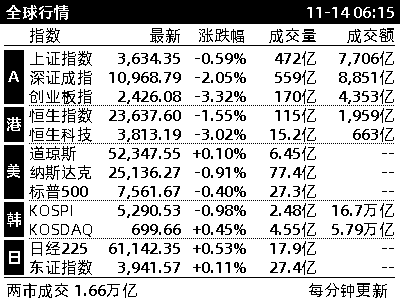

# 全球行情数据面板 → 400×300 设备图

把 A、港、美、韩、日 12 个指数的最新点位、涨跌幅、成交量和成交额渲染成 RLCD 4.2 英寸设备可直接显示的一页 1bpp 位图。



新固件（v1.8.7 起）每分钟直连行情接口，在设备上自己画这张面板；这里的渲染器由 GitHub Actions 定时运行，输出同款位图到仓库根目录的 `aibrief/`，供旧固件显示，并在设备直连失败时兜底。面板内容、页脚状态和两条更新链路的说明见 [`docs/Aibrief_zh.md`](../docs/Aibrief_zh.md)。

## 文件

| 文件 | 作用 |
| --- | --- |
| `market_quotes.py` | 数据层（只用标准库）：四个行情接口的地址、解析、单位换算、多源合并和数字格式 |
| `render_brief.py` | 排版与输出：画面板、排版预检、写设备负载和预览 |
| `mono_text.py` | FreeType 单色（MONO + 自动 hinting）文字渲染，字宽与固件的 LVGL 字库一致 |
| `fixtures_tool.py` | 生成 / 校验 `fixtures/` 里服务器与固件共用的期望值和基准图 |
| `fixtures/` | 留档的接口实测响应（2026-11-13 收盘），以及由它们生成的期望值和三张基准图 |
| `test_render_brief.py` | 回归测试，不联网 |
| `fonts/` | 阿里巴巴普惠体 3.0 Regular / Bold |

## 用法

```bash
python3 -m pip install pillow==13.0.0 freetype-py==2.5.1

# 回归测试（不联网）
python3 device_brief/test_render_brief.py

# 离线演示：用 fixtures/ 里留档的数据出图，顶栏会标「离线演示」
python3 device_brief/render_brief.py --demo --out-dir /tmp/market-panel

# 实抓行情并更新正式目录；有效行情不足时保留上一版
python3 device_brief/render_brief.py --out-dir aibrief --require-live
```

| 参数 | 说明 |
| --- | --- |
| `--out-dir DIR` | 输出目录，默认 `aibrief` |
| `--demo` | 不联网，使用 `fixtures/` 里的数据 |
| `--require-live` | 有效行情少于 `--min-rows` 行时退出 3，不写任何文件；演示数据不算有效行情 |
| `--min-rows N` | 12 行里至少多少行取到最新点位才更新，默认 9（与固件的 `kMinLiveRows` 相同） |

退出码：`0` 成功（包括行情没变、无需更新），`3` 有效行情不足，`5` 排版预检未通过。后两种情况都保留上一版文件。

输出：

- `latest.bin`：设备负载，`AIB1` + 宽高 + 15000 字节位图，共 15008 字节。
- `version.txt`：设备比对用的小清单（`sha256` / `pages` / `bytes` / `generated_at`）。
- `latest.png`：同一张图的 PNG 预览。
- `meta.json`：每行的原始数值、单元格文字、数据来源和行情时间。

行情与上一版逐位相同时，四个文件都不重写（`meta.json` 里的生成时间也不更新），工作流因此不会产生空提交。旧版多页简报留下的 `page_*.png`、`latest_combined.png`、`latest_contact_sheet.png` 会在下一次运行时被清掉。

## 数据源与合并规则

| 数据源 | 用途 |
| --- | --- |
| 腾讯证券 `qt.gtimg.cn` | A、美指数整行；港股指数的点位、涨跌幅、成交额；日韩指数的点位（备用） |
| 新浪财经 `hq.sinajs.cn`（需要 `Referer`） | 港股指数的成交股数；腾讯缺行时提供整行 |
| Naver 金融 `polling.finance.naver.com` | KOSPI / KOSDAQ 整行；日经 225 成交量；东证指数整行 |

- 日经 225 盘中用腾讯的实时点位加 Naver 的成交量；Naver 标记收盘、腾讯缺行或两者点位相差超过 3% 时整行用 Naver。
- 东证指数只用 Naver（腾讯和新浪的 TOPIX 数据不可用）。
- 美股、日本指数没有可靠的成交额，固定显示 `--`。
- 点位不大于 0 或涨跌幅绝对值超过 50% 的行按脏数据丢弃。
- 单个数据源失败只影响它负责的行或列，不影响其余数据。

## 排版

- 画布 400×300，只有纯黑和纯白；全页阿里巴巴普惠体 3.0、16px，数字串、顶栏标题和市场色块用 Bold，其余用 Regular。
- 文字用 FreeType `FT_LOAD_TARGET_MONO + FT_LOAD_FORCE_AUTOHINT` 直接生成 1bpp 字形，落在整数像素上；字宽取 LVGL 字库的 `adv_w`（四舍五入到 1/16 像素），不做字距调整，这样服务器位图和固件自绘逐像素相同。
- 保存前预检：尺寸、字号、文字越界、文字互相重叠、灰阶像素，任何一项不通过都不写文件。
- 页脚右侧 `x=194..388`、`y=279..300` 留白，设备在这里写「每分钟更新」或「读取 HH:MM」。

## 改动版面、格式或数据源时

服务器和固件各有一份实现，必须同步改：

1. 改 `render_brief.py` / `market_quotes.py`，同时改固件的 `RLCD_CLOCK/main/ui/ui_market_panel_layout.h`、`ui_market_panel_render.cpp`、`RLCD_CLOCK/main/network/market_panel_contract.h`（接口地址在 `main/core/app_network_config.h`）。
2. 面板新增了文字：把字补进 `RLCD_CLOCK/tools/gen_market_panel_fonts.py` 的清单并重新生成字库。
3. `python3 device_brief/fixtures_tool.py --write` 重新生成期望值和基准图。
4. 运行 `test_render_brief.py` 和固件主机测试 `market_panel_contract_test`、`market_panel_view_test`（命令见 [`docs/Aibrief_zh.md`](../docs/Aibrief_zh.md)）。

## 定时任务

`.github/workflows/aibrief.yml`：

- 定时 `*/5 * * * *`，另外在渲染器、fixtures 或固件里对应的常量文件有改动时立即运行。
- 代码改动和手动触发时先跑回归测试；定时运行只渲染（渲染器保存前自带排版预检）。
- 只有默认分支上的运行会提交 `aibrief/`；其他分支渲染到临时目录并上传为工作流产物。
- 有效行情不足（退出码 3）时只给出警告，不算失败。
- GitHub 的定时任务经常延后或被跳过，实际间隔会长于 5 分钟。
- 开盘时段行情每次都在变，`main` 上最多每 5 分钟多一个 `Update market panel device image` 提交。设备全部升级到新固件后，可以把 cron 调稀（例如 `*/30 * * * *`），位图只剩兜底用途。
