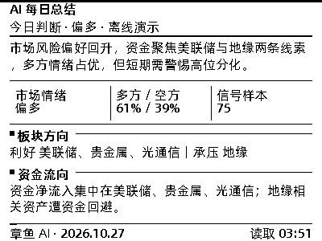

# 章鱼 AI 简报 → 400×300 设备图（多页轮播 / 杂志网格 2.0）

把 [k-macao/002](https://github.com/k-macao/002) 的「全景分析」编辑成 RLCD 4.2 英寸设备可直接显示的多页 1bpp 位图。每页固定 400×300，设备每 60 秒自动轮播；网页保留完整研报，设备端采用适合小屏阅读的杂志编辑版。



[查看 48 页完整校样墙（离线示例数据，全量快讯用满页位）](sample_contact_sheet.png)

## 屏幕、字体与网格

- **画布先适配设备**：所有页面先按 400×300 排版，正文安全区为 `x=12..388`、`y=48..273`，页眉、正文、页脚分区固定，不使用图片缩放来迁就内容。
- **统一阿里巴巴普惠体 3.0、全页 16px**：标题、正文、标签、页眉和页脚均为 16px；页标题、栏目标题、卡片标题和快讯标题，以及数字及其数值串符号使用 `85 Bold`，其余文字使用 `55 Regular`，不描边、不叠影。渲染机读取 `device_brief/fonts/AlibabaPuHuiTi-3-55-Regular.ttf` 和 `AlibabaPuHuiTi-3-85-Bold.ttf`，可分别通过 `ALIBABA_PUHUITI_FONT`、`ALIBABA_PUHUITI_BOLD_FONT` 覆盖路径；缺少字体时直接停止，不回退其他字体家族。
- **按混合字重真实测量**：标题和正文均按各自字重测量；小数、百分比、日期和时间作为完整数值串参与测量与折行，不在数值中间断行；4.2 英寸面板约 120dpi，不通过缩字塞内容。
- **原生 1bpp 清晰渲染**：`mono_text.py` 使用 FreeType `FT_LOAD_TARGET_MONO + FT_LOAD_FORCE_AUTOHINT` 直接生成黑白字形，所有字形落在整数像素上，测量与绘制共用同一套整数 advance。不再经过灰度图、128 阈值、抖动或亚像素定位；页面预检只允许纯黑/纯白两类像素。面板本身是 1bpp，不能显示真正的灰阶抗锯齿，因此不制造噪点来假装平滑。
- **杂志式版面**：统一 running header/footer、右下读取时间（不再显示页码）、阅读进度线；总结页使用指标行，行情页使用指数数据网格，热力图使用双栏数据卡，快讯使用双栏流并对末页做左右栏高度均衡。
- **完整折行而非截句**：超长中英文标题会跨栏或跨页续排，结尾不省略。页脚只保留读取时间，页码已取消；阅读进度线仍按总页数推进。
- **快讯全量推送**：默认把抓到的所有标题都排进去（`--news-per-source 0`），并按各来源轮转排序，任何截断点都各源均衡；只有 48 页装不下时才二分收敛到「页数不超上限的最大条数」，页眉标注「全量 N 条取 M 条」。

## 推送前逐页预检

`MultiPageRenderer.save()` 必须先完成全部页面，再逐页检查；任一项失败都不会创建或覆盖设备文件：

1. 画布必须为 400×300，页数必须在本次预算及固件 1..48 页范围内。
2. 所有文字必须恰好为 16px，不得越出画布或侵入页眉/页脚。
3. 按 Regular/Bold 混合字重检查文字 bounding box，发现叠字直接失败。
4. 逐页扫描像素，出现任何灰阶值就停止发布，确保设备收到原生 1bpp 点阵。
5. 全部通过后才写入二进制和 PNG；页数减少时同步清理旧 `page_*.png`，避免残页混入。
6. 同时生成 5 列校样墙，行数按实际页数计算，便于推送前逐页目检。

运行 29 项离线回归测试：

```bash
python3 -m pip install pillow freetype-py
python3 device_brief/test_render_brief.py
```

测试覆盖全页阿里巴巴普惠体 16px、标题/数字 Bold 与其他 Regular、MONO 字体调用、整数像素、纯黑白页面与灰阶阻断、数值串完整折行、单页/多页协议、右下读取时间（无页码）、安全区、文字叠压、40 个热力关键词、超长英文完整续排、页数预算自适应、离线演示、旧校样清理、每日两次 schedule、北京时间及旧行情阻断发布。

实现参考 [FreeType 的单色 hinting 说明](https://github.com/freetype/freetype/blob/master/include/freetype/freetype.h)与 [freetype-py 的 MONO 示例](https://github.com/rougier/freetype-py/blob/master/examples/glyph-monochrome.py)。同时对比了 [ttfautohint-py](https://github.com/fonttools/ttfautohint-py) 预处理、不同阈值及像素字体方案；预处理没有带来足够收益，像素字体则会改变既定字体并存在字符覆盖问题，因此均未采用。真机 [lv_font_conv](https://github.com/lvgl/lv_font_conv) 在 `bpp=1` 时已经使用 MONO 与自动 hinting，无需增加灰阶或子像素格式。

## 用法

```bash
# 完全离线的排版校样，不请求新闻或行情接口
python3 device_brief/render_brief.py --demo --out-dir /tmp/rlcd-brief

# 实时数据；实时源、A 股新鲜度和全部排版预检通过后才更新正式目录
python3 device_brief/render_brief.py --out-dir aibrief --require-live --require-fresh-market
```

输出：

- `latest.bin`：设备负载（`AIB1` + 宽高 + N×15000 字节位图，N=1..48）。
- `latest.png`：首页 PNG。
- `page_*.png`：每页原生 400×300 PNG。
- `latest_combined.png`：垂直拼接总览。
- `latest_contact_sheet.png`：5 列全页校样墙，供推送前审阅。
- `meta.json`：北京时间生成时间、实际页数、字体、实时源、A 股新鲜度结果、快讯口径（`news_mode` / `news_full` / `news_limit`）、安全区、校验值及 `layout_validated=true`。

常用参数：

| 参数 | 说明 |
| --- | --- |
| `--demo` | 完全离线，使用 002 内置样例和行情快照 |
| `--require-live` | 实时源少于阈值时退出 3，不更新设备图 |
| `--require-fresh-market` | A 股不是最新可复盘交易日、接口不可用或回退旧快照时退出 3 |
| `--min-live-sources N` | 实时源阈值，默认 20 |
| `--limit N` | 每个来源抓取的条目数，默认 20（与 002 会员推送口径一致） |
| `--news-per-source N` | 快讯每源条数；默认 `0` = 全量推送，放不下时自动收敛 |
| `--pages N` | 本次最大页数；0 表示固件上限 48，不会直接裁掉超额页面 |

退出码 `3` 表示实时源不足或行情不新鲜；退出码 `5` 表示排版预检未通过或分析内容本身超过页位。两种情况都保留上一版文件。

## 内容分页与 48 页编辑预算

1. **AI 每日总结**：市场情绪、多空比例、信号样本、板块方向、资金流向。
2. **AI 看盘·A股 / 港股 / 美股**：指数、成交、市场广度、板块、资金与策略；标准六维复盘按“指数与成交 / 板块与策略”组织。
3. **AI 情绪热力图**：全部命中关键词（最多 40 个）的热度、净信号、情绪和港股 ETF 代码；重复的长产品说明留在网页研报。
4. **AI 政策分析**：8 大政策维度、鹰鸽取向、净多空、源数与提及数。
5. **AI 板块机会**：机会 Top4 + 承压 Top2，每个方向保留一条代表证据及 ETF 代码。
6. **全网快讯**：6 大板块、69 源、跨源去重、连续编号、完整标题双栏分页。

设备协议最多 48 页（PSRAM 720KB）。渲染器先完整排分析栏目，再按 **全量快讯** 用二分法寻找「页数不超过 48 的最大条数」，把页位用满：每个来源按轮转顺序出条，例如全量 287 条时可排出 104 条 / 48 页，各源纳入条数相差不超过 1 条。页眉标注“全量 N 条取 M 条”，`meta.json` 记录 `news_available / news_included / news_omitted / news_limit`。不会缩字、截句或直接删除超出页位的内容；分析栏目本身超过 48 页时退出 5，不推送半成品。若显式指定 `--news-per-source N`，则按该口径精选，放不下时沿 20 → 16 → 12 → 8 → 6 → 5 → 4 → 3 → 2 → 1 逐级收敛。

> 正式渲染机需要能访问 002 的数据源。GitHub Actions（`.github/workflows/aibrief.yml`）每天 **07:10、19:10（北京时间）各实时抓取一次**，先跑排版测试，再检查实时源和 A 股新鲜度，随后逐页预检、生成校样并提交；任何数据闸门失败都保留上一版。设备会在 5 分钟内获取新图，每 60 秒自动翻页，之后每 5 分钟检查更新。
