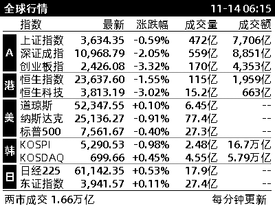

# 全球行情数据面板（设备主页）

设备主页只有一页：400×300 的「全球行情」数据面板，按 **A、港、美、韩、日** 的顺序列出 12 个指数的最新点位、涨跌幅、成交量和成交额，**每分钟更新一次**。原来的多页「章鱼 AI 简报」（AI 总结、快讯、政策分析等）已全部移除。



> 代码、目录和工作流沿用 `aibrief` 这个名字（`aibrief/latest.bin`、`ui_aibrief_page.cpp`、`aibrief.yml`）：面板占用的就是原简报页的位置，旧固件也继续从同一地址读取位图。

## 面板内容

| 市场 | 指数 |
| --- | --- |
| A | 上证指数、深证成指、创业板指 |
| 港 | 恒生指数、恒生科技 |
| 美 | 道琼斯、纳斯达克、标普500 |
| 韩 | KOSPI、KOSDAQ |
| 日 | 日经225、东证指数（TOPIX） |

- **列**：指数｜最新｜涨跌幅｜成交量｜成交额。成交量单位是股，成交额是当地货币（元 / 港元 / 韩元），都按 万 / 亿 / 万亿 缩写，例如 `472亿`、`1.66万亿`。
- **页眉右侧**：全表最新一笔行情的时间，北京时间 `MM-DD HH:MM`。休市时它停在最后一个收盘的市场上。
- **页脚左侧**：`两市成交`，上证指数与深证成指两行成交额之和。
- **页脚右侧**：更新状态，见下表。
- 取不到的数据显示 `--`。**美股和日本指数的成交额固定是 `--`**：数据源不提供可靠数值（腾讯美股指数的成交额字段是无意义值，Naver 日本指数的成交额字段单位有误或为空）。
- 日本指数的成交量和东证指数的点位来自 Naver 环球指数接口，**延迟约 15 分钟**；日经 225 的点位盘中用腾讯的实时值。
- 港股指数用腾讯的实时代码（`r_hkHSI`、`r_hkHSTECH`）。不带 `r_` 的 `hkHSI` / `hkHSTECH` 延迟 15 分钟（2026-11-16 盘中实测），不要换回去。

| 页脚右侧 | 含义 |
| --- | --- |
| `每分钟更新` | 设备直连行情接口，最近 3 分钟内刷新成功过 |
| `N 分钟未更新` | 直连已经 N 分钟没有成功，屏幕上是上一次的数据 |
| `低电量 暂停更新` / `离线模式 暂停更新` | 设备处于低电量或离线模式，不联网；屏幕上是上一次的数据 |
| `读取 HH:MM` | 正在显示服务器位图（旧固件，或新固件直连失败时的兜底），时间是设备读到这张图的时刻 |

全页阿里巴巴普惠体 3.0、16px：数字串、顶栏标题和市场色块用 `85 Bold`，其余文字用 `55 Regular`。

## 按键

- **BOOT 短按**：立即刷新一轮行情（两次至少间隔 10 秒；离线模式和低电量时不响应）。
- **长按 KEY**：进入「设置」，设置关闭后回到面板。
- 「设置 → 网络 → 行情面板」：关闭设置回到面板并立即刷新。

首次开机、还没取到任何数据时显示「行情数据尚未获取 / BOOT 立即刷新 · 长按 KEY 进入设置」。

## 两条更新链路

### 1. 设备直连行情接口（固件 v1.8.7 起，每分钟）

1. 界面任务每 **60 秒** 请求一轮刷新（`kRefreshSeconds`）；网络任务打开 Wi-Fi，依次请求四个公开行情接口，全部无需密钥。
2. 腾讯是主干源（最多试 2 次）；腾讯成功后再取新浪和 Naver（韩、日共用一条 keep-alive 连接）。
3. 合并四个源，12 行里至少 **9 行** 有效才算成功（`kMinLiveRows`），随后发布到界面。某个辅助源这一轮失败时，它负责的行沿用上一轮的数值，最多沿用 10 分钟。
4. 行情文字和上一轮完全相同（例如休市）时不重绘屏幕。
5. 每轮结束后关闭 Wi-Fi，下一轮重新连接。

失败处理：

- 连续失败 3 轮后，刷新间隔从 1 分钟退到 5 分钟，成功一次即恢复。
- 新浪或 Naver 连续失败 3 轮后，每 10 轮才再试一次，避免每分钟都为它等超时。
- 直连失败时改去下载服务器位图（两次下载至少间隔 5 分钟）。实时数据超过 10 分钟没刷新、而位图读取得更晚时，屏幕改显示位图，页脚写 `读取 HH:MM`；直连恢复后自动切回。
- 离线模式和低电量模式下不发起任何请求。

> 每分钟联网一次比原先每 5 分钟比对一次清单更耗电；电池供电时续航会缩短，实际数值尚未实测。

| 数据源 | 地址 | 提供的数据 |
| --- | --- | --- |
| 腾讯证券 | `qt.gtimg.cn` | A / 港 / 美指数的点位、涨跌幅；A 股成交量与成交额、港股成交额、美股成交量；日韩指数的点位（备用） |
| 新浪财经 | `hq.sinajs.cn` | 港股指数的成交股数（腾讯缺行时提供整行） |
| Naver 金融 | `polling.finance.naver.com` | KOSPI / KOSDAQ 整行；日经 225 成交量与收盘后的整行；东证指数整行 |

### 2. 服务器位图（旧固件使用，新固件兜底，每分钟）

- `.github/workflows/aibrief.yml` 里有一个常驻循环（`device_brief/publish_loop.py`），**每 60 秒**运行一次 `device_brief/render_brief.py`，用同样的四个数据源渲染一张同款面板，写到仓库根目录的 `aibrief/` 并提交到 `main`。
- 行情没有变化时不写文件、不产生提交（休市期间没有提交）；有效行情不足 9 行时保留上一版。
- 只有默认分支（`main`）上的运行会提交设备图；其他分支只跑测试、渲染一次，并把预览（含 PNG）存成工作流产物。
- 旧固件（v1.8.6 及更早的简报版）**每 5 分钟**比对一次 `aibrief/version.txt`，内容变化才下载；它会把这张单页位图当成只有 1 页的简报显示，页脚右侧写 `读取 HH:MM`。所以旧固件上是「每 5 分钟刷新一次，刷新到的是一分钟内的数据」，**要在设备上每分钟刷新必须使用新固件**。
- 新固件直连失败时最多每 5 分钟读一次这张位图。

位图里页脚右侧（`x=194..388`、`y=279..300`）留白，由设备填写状态文字。

#### 每分钟发布靠什么保持运行

GitHub 的定时任务（`schedule`）不保证准点：本仓库 `*/5 * * * *` 的定时器在 11 小时里只触发了两次，更早的每 3 小时一次的任务实际间隔是 4～9 小时。所以每分钟的更新不靠定时器，而是让一个任务常驻：

1. **循环**：每 60 秒抓一次行情、渲染一次，画面有变化就提交并推送。推送被拒绝（`main` 上刚好多了别的提交）时把结果叠到最新提交上重试。
2. **接力**：单个任务最长 6 小时，所以一轮只跑 5.5 小时。每一轮正常运行 5 分钟后就预约好下一轮：同一分支只允许一个循环在跑，预约的运行会一直排队，等当前这轮结束（跑满、出错、被取消或执行机故障）就自动开始。**Actions 页面上平时总有一个运行中的和一个排队中的运行，这是正常状态。**
3. **让位**：有代码推送或有人手动 Run workflow 时，正在跑的循环在一分钟内收尾，由新的运行接管。
4. **看门狗**：`.github/workflows/aibrief-watchdog.yml` 每小时两次（同样不保证准点）检查有没有运行中或排队中的循环，一个都没有时把它重新拉起。发现停更时也可以直接手动 Run workflow「生成行情数据面板设备图」。

每一轮结束时会在运行摘要页留一条说明，例如 `共 330 个周期：发布 212，无变化 118，发布失败 0，行情不足或超时 0，渲染出错 0；后继已在排队`。

#### 代价、调节与停止

- **提交量**：交易时段每分钟一个 `Update market panel device image` 提交。亚洲时段约 8 小时、美股时段约 6.5 小时，每个交易日约 870 个，`main` 的提交历史里绝大多数会是它们；看代码历史时用 `git log -- . ':(exclude)aibrief'` 过滤。
- **仓库体积**：每个提交打包后，亚洲时段（9 行在变）实测约 4 KB，美股时段（3 行在变）按模拟约 1.7 KB；据此估算每个交易日约 2.6 MB，一年约 0.65 GB（仓库目前约 240 MB）。每分钟发布时不保存 PNG 预览就是为了控制它：带上 PNG 每个提交 7～9 KB，一年约 1.7 GB。
- **执行机**：一个任务全天占用一台 GitHub 托管的执行机。公开仓库目前不计费，但这不是 GitHub Actions 的典型用法（它面向构建、测试和发布），GitHub 有可能限制这类长期占用。
- **调节**：改 `aibrief.yml` 里的 `INTERVAL_SECONDS`，例如 `"300"` 即每 5 分钟，提交量和体积增长降到约五分之一。旧固件每 5 分钟才读一次，新固件只在直连失败时读，设备都升级到新固件后可以调大。
- **停止**：先在 Actions 页面把「生成行情数据面板设备图」和「行情面板看门狗」都 Disable，再把运行中和排队中的运行都取消。只取消不 Disable，排队的那一轮会接着跑。

## 位图负载格式

`aibrief/latest.bin`：

```
偏移  长度     含义
0     4        魔数 "AIB1"
4     2        宽度（小端，固定 400）
6     2        高度（小端，固定 300）
8     15000    1bpp 位图，逐行 MSB 优先，bit=1 表示黑
```

- 固定 1 页、15008 字节。新固件只接受 1 页（`aibrief::kMaxPages`）；清单声明多页或超过 15008 字节时直接跳过，不下载。
- `aibrief/version.txt`：`manifest=1 sha256=… pages=1 bytes=15008 generated_at=…`，设备先比对 `sha256` 再决定是否下载。
- `aibrief/meta.json` 记录每行的原始数值、单元格文字、数据来源和行情时间，和 `latest.bin` 同一次提交更新。
- `main` 上每分钟发布时不保存 PNG 预览（`aibrief/latest.png` 会在合并后的第一次发布时被删掉）：PNG 无法增量压缩，占每次提交体积的一半以上，而设备不读它。要看图可以本地运行渲染器（见下），或在任意分支上运行工作流后下载产物 `market-panel-device-image`。

渲染器用法见 [`device_brief/README.md`](../device_brief/README.md)。

## 固件接口

| 文件 | 作用 |
| --- | --- |
| `main/network/market_panel_contract.h` | 纯逻辑：行目录、四个接口的解析、合并规则、数字格式、行情时间换算、刷新与退避节奏 |
| `main/network/market_panel_state.*` | 互斥保护的 12 行行情、版本号、刷新请求节流 |
| `main/network/market_panel_service.*` | HTTPS 抓取、合并、发布；直连失败时触发位图兜底 |
| `main/ui/ui_market_panel_layout.h` | 版面坐标与固定文字（与 `render_brief.py` 的常量一一对应） |
| `main/ui/ui_market_panel_render.*` | 把面板画成 400×300 的 1bpp 位图 |
| `main/ui/ui_aibrief_page.*` | 主页：在实时面板、服务器位图和占位提示之间选择并显示 |
| `main/network/aibrief_contract.h`、`aibrief_state.*`、`aibrief_service.*` | 位图兜底通道：清单比对、下载、校验（单页） |
| `main/assets/market_panel_text_16.c`、`market_panel_bold_16.c` | 面板用的两套 16px 字库，由 `tools/gen_market_panel_fonts.py` 生成 |

行情刷新复用事件位 `kAibriefSyncBit`，与天气、说说的联网窗口互不阻塞。

## 服务器与固件保持一致

面板的解析、数字格式和版面在服务器（Python）和固件（C++）里各实现了一遍，靠 `device_brief/fixtures/` 里的同一批文件互相校验：

- `test_render_brief.py` 逐项比对两边的版面坐标、固定文字、行顺序、阈值和接口地址；
- 固件主机测试 `tests/market_panel_contract_host_test.cpp` 用留档的接口响应核对解析、合并和格式结果；
- `tests/market_panel_view_host_test.cpp` 要求固件自绘的位图与服务器渲染的基准图逐像素相同。

改动任何一边后运行：

```bash
# 服务器侧（仓库根目录）
python3 device_brief/test_render_brief.py
python3 device_brief/fixtures_tool.py --write   # 有意改动格式或版面后重新生成期望值与基准图

# 固件侧主机测试（需要 SDL2；LVGL 8.4.0 源码不在默认位置时加 -DWEATHER_CLOCK_LVGL_DIR=<路径>）
cd RLCD_CLOCK
cmake -S simulator -B simulator/build
cmake --build simulator/build --target market_panel_contract_test market_panel_view_test aibrief_contract_test
./simulator/build/market_panel_contract_test
./simulator/build/market_panel_view_test
./simulator/build/aibrief_contract_test
```

## 版本号自动递增

- `RLCD_CLOCK/CMakeLists.txt` 的 `PROJECT_VER` 为当前版本
- `.github/scripts/bump_version.py` 自动递增 PATCH（v1.8.0 -> v1.8.1）
- `build-release.yml` 在 tag 推送构建成功后，自动 bump 版本并推送到 main（`[skip ci]`）
- 手动指定版本：`python3 .github/scripts/bump_version.py --set v1.9.0`

## 首次把设备升级到本仓库固件

1. 打开[在线上位机](https://wickenzh.github.io/ESP32-S3-RLCD-4.2/)，用 Web Serial 连接设备。
2. 在「自定义资源」中新增 `type=4` 文本，内容填 `https://raw.githubusercontent.com/k-macao/04-rlcd/main`（会自动规范化为 `/firmware/latest.json`）。
3. 写入资源后重启设备。
4. 设备进入「设置 → 系统 → 检查更新」，选择 v1.8.0 安装；安装完成会自动重启。

备用清单为 `https://cdn.jsdelivr.net/gh/k-macao/04-rlcd@main/firmware/latest.json`，主源不可达时可改填该地址。
